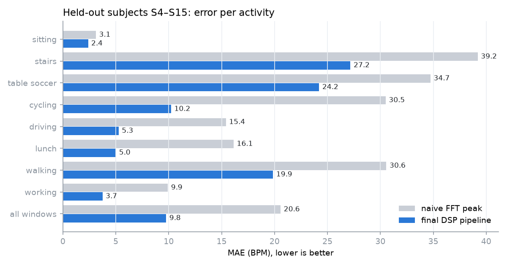

# PPG heart-rate pipeline: DSP vs NN, embedded C, multi-level tests

Wrist-PPG heart-rate estimation on PPG-DaLiA, compared across a classical DSP pipeline
and a neural network, ported to fixed-point embedded C (emulated Cortex-M), tested at
the unit / regression / equivalence / software-in-the-loop levels, plus a live webcam demo.

> Work in progress: Stages 1–3 done (classical DSP, fixed-point firmware, multi-level tests + CI).

## Stage 1 results: classical DSP (Python)

```
PPG 64 Hz ─► bandpass 0.5–4 Hz ─► NLMS motion cancel (ACC ref) ─► 8 s FFT ─► ACC spectral mask ─► HMM tracker ─► BPM
ACC 32 Hz ─► resample 64 Hz, bandpass ─┘──────────────────────────────────────┘
```

Mean absolute error vs ECG reference, parameters tuned on S1–S3, **evaluated on held-out S4–S15**:

| variant | MAE (BPM) |
|---|---|
| naive FFT peak | 20.8 |
| + bandpass | 19.5 |
| + NLMS motion cancellation | 18.6 |
| + HMM tracker | 13.4 |
| + ACC spectral mask (final) | **9.7** |
| final without NLMS | 11.3 |

Per activity, naive → final: sitting 3.1 → 2.4, cycling 30.5 → 10.2, walking 30.6 → 19.9, stairs 39.2 → 27.2
(numbers from `reports/stage1_results.md`; the pipeline was made fully causal in Stage 2).
Full tables: [`reports/stage1_results.md`](reports/stage1_results.md).

## Stage 2 results: fixed-point C firmware (emulated ADI MAX32652, Cortex-M4)

Integer-only C99, no malloc / libc, streaming sample by sample; MAX30102 driver behind an
I2C HAL, tested against a register-level mock fed with PPG-DaLiA data; run in Renode.

| | |
|---|---|
| fixed-point vs float: identical HR windows | **99.93%** (64,652 / 64,697), test MAE 9.72 vs 9.72 BPM |
| emulated MCU output vs host build | bit-exact (57/57 estimates) |
| instructions per sample / per 2 s window | 2,474 / 3.39 M |
| CPU load @120 MHz (1 instr/cycle, measured instr. counts) | ~1.6% |
| flash / static RAM (pipeline + driver) | 12.8 KB / 25.1 KB |
| native C on laptop (Apple M4) | ~550 ns per sample |

Details and caveats (emulator timing is not real-hardware timing): [`reports/stage2_results.md`](reports/stage2_results.md).


## Stage 3: testing at every level, in CI

```
 6  software-in-the-loop   pytest streams real PPG-DaLiA frames over a serial port (pty) at 64 Hz
                           to the firmware: native build AND emulated MAX32652 (Renode). Checks
                           HR values (bit-exact), latency, checksum/sequence errors, resync.
 5  dataset regression     per-activity MAE limits on held-out subjects; final must beat naive
 4  equivalence            C fixed point (ctypes) vs Python float: per block + 99.5%/subject
 3  end-to-end synthetic   known HR, motion artifact rejection, HR ramp; Python and C
 2  data sanity            sampling rates, units, label alignment of the dataset
 1  unit                   Python DSP blocks; C: fixed-point math vs libm, driver vs mock;
                           Cortex-M4 build must be warning-free
```

132 pytest tests (+89 C checks) in ~2 min. GitHub Actions runs all of them, including SIL on the
emulated MCU, and publishes a report (tables + plots) as the job summary and an artifact:
`.github/workflows/ci.yml`, `python/scripts/ci_report.py`.

| | |
|---|---|
| SIL native, HR latency at 64 Hz (median / max) | 0.4 / 0.6 ms |
| SIL emulated MCU, HR latency (host clock, median / max) | 12.6 / 13.7 ms |

```bash
uv run pytest                      # everything
uv run pytest -m "not renode"      # without the emulator
uv run pytest -m "not dataset"     # without PPG-DaLiA (synthetic + equivalence blocks + C)
```




## Layout
```
python/ppg_hr/     library code (data loading, DSP, models)
python/scripts/    runnable scripts (data prep, plots, evaluation)
firmware/          C firmware (Stage 2)
tests/python/      pytest suites
reports/figures/   generated plots
data/              dataset (git-ignored)
```

## Setup
```bash
uv sync
# download PPG-DaLiA (~2.7 GB) from UCI into data/raw/ppg_dalia.zip, then:
uv run python python/scripts/prepare_data.py
uv run pytest
uv run python python/scripts/plot_raw.py S1
uv run python python/scripts/run_stage1.py   # all variants, all subjects -> reports/
```
