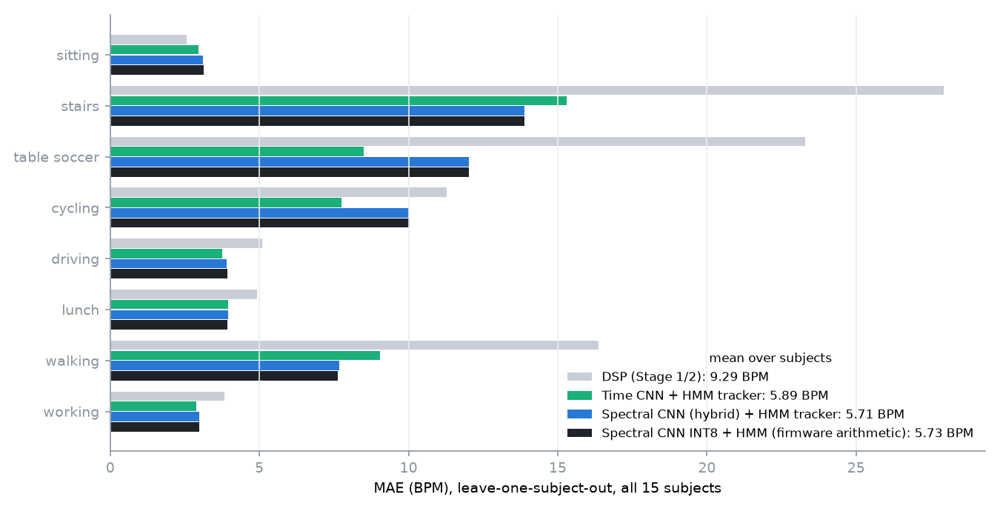
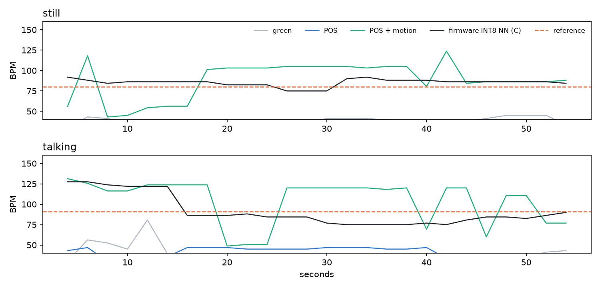

# TinyPulse: heart rate from light, from algorithm to microcontroller

[](https://github.com/egurita/tinypulse/actions/workflows/ci.yml)

Smartwatches measure your pulse by shining light into the skin and measuring how much comes
back: with every heartbeat the blood volume changes, and so does the light (PPG,
photoplethysmography). The hard part is movement: when you walk or climb stairs, the arm's
motion disturbs the signal far more than the heartbeat does.

This project builds the whole chain a sensor company ships, end to end: the signal-processing
algorithm, a small neural network, integer firmware for a microcontroller, and an automated
test system around all of it. It then reuses the same pipeline to read heart rate from a
laptop webcam. No special hardware was used: a public dataset stands in for the watch and an
emulator for the chip.

## Highlights

| | |
|---|---|
| Accuracy: 15 people, everyday activities, checked against a chest ECG | classical DSP 9.3 BPM average error → **5.7 BPM** with a 3,000-parameter neural network |
| Hardest case: climbing stairs | error cut in half, 28 → **14 BPM** |
| Runs on a microcontroller (Analog Devices MAX32652, Arm Cortex-M4, emulated) | **~3% CPU**, 3.6 KB of network weights, integer-only C; results **bit-identical** to the Python reference |
| Automated testing | **151 tests on 7 levels**, from single functions to real-time data streamed over a serial link to the emulated chip; GitHub Actions on every push |
| Webcam demo | live heart rate from tiny colour changes of the face; first test at rest: 84 BPM vs 80 BPM on a smartwatch |

**Skills:** digital signal processing (filters, FFT, adaptive noise cancellation, tracking) ·
embedded C (fixed point, no dynamic memory, MAX30102 sensor driver over I2C, memory and CPU
budgets) · test automation (pytest, C unit tests, regression, equivalence, software-in-the-loop,
CI) · machine learning (PyTorch CNNs, leave-one-subject-out validation, INT8 quantization, own
C inference) · computer vision (OpenCV face detection, remote PPG).

```
 wrist light sensor (PPG) ─┐
 + accelerometer           ├─► filter ─► cancel motion ─► spectrum ─► DSP rules or CNN ─► tracker ─► BPM
 webcam: face skin colour ─┘                                         (motion reference)
     + face movement

 the same algorithm exists twice:  Python (float, research)  ==  C firmware (integer, MCU)
 checked against each other by the test suite, on the laptop and on the emulated Cortex-M4
```

**Contents:** [Signal processing](#1-signal-processing-python) · [Firmware](#2-embedded-firmware-fixed-point-c-on-an-adi-cortex-m4) · [Testing](#3-test-automation-7-levels-in-ci) · [Neural network](#4-neural-network-vs-dsp-int8-on-the-microcontroller) · [Webcam](#5-webcam-heart-rate-remote-ppg) · [Run it](#setup)

## 1. Signal processing (Python)

```
PPG 64 Hz ─► bandpass 0.5–4 Hz ─► NLMS motion cancel (ACC ref) ─► 8 s FFT ─► ACC spectral mask ─► HMM tracker ─► BPM
ACC 32 Hz ─► resample 64 Hz, bandpass ─┘──────────────────────────────────────┘
```

Mean absolute error vs ECG reference, parameters tuned on S1–S3, **evaluated on held-out S4–S15**:

| variant | MAE (BPM) |
|---|---|
| naive FFT peak | 20.8 |
| + bandpass | 19.5 |
| + NLMS motion cancellation | 18.6 |
| + HMM tracker | 13.4 |
| + ACC spectral mask (final) | **9.7** |
| final without NLMS | 11.3 |

Per activity, naive → final: sitting 3.1 → 2.4, cycling 30.5 → 10.2, walking 30.6 → 19.9, stairs 39.2 → 27.2
(the final pipeline is fully causal, i.e. it only uses past samples, as on a real device).
Full tables: [`reports/stage1_results.md`](reports/stage1_results.md).

## 2. Embedded firmware: fixed-point C on an ADI Cortex-M4

Target: Analog Devices MAX32652 (Arm Cortex-M4F, 120 MHz), emulated in Renode. Integer-only C99, no malloc / libc, streaming sample by sample; MAX30102 driver behind an
I2C HAL, tested against a register-level mock fed with PPG-DaLiA data; run in Renode.

| | |
|---|---|
| fixed-point vs float: identical HR windows | **99.93%** (64,652 / 64,697), test MAE 9.72 vs 9.72 BPM |
| emulated MCU output vs host build | bit-exact (57/57 estimates) |
| instructions per sample / per 2 s window | 2,475 / 3.58 M |
| CPU load @120 MHz (1 instr/cycle, measured instr. counts) | ~1.6% |
| flash / static RAM (DSP pipeline + driver) | 13.0 KB / 30.2 KB (+4 KB stack, 1.1 KB used) |
| native C on laptop (Apple M4) | ~550 ns per sample |

Details and caveats (emulator timing is not real-hardware timing): [`reports/stage2_results.md`](reports/stage2_results.md).


## 3. Test automation: 7 levels, in CI

```
 6  software-in-the-loop   pytest streams real PPG-DaLiA frames over a serial port (pty) at 64 Hz
                           to the firmware: native build AND emulated MAX32652 (Renode). Checks
                           HR values (bit-exact), latency, checksum/sequence errors, resync.
 5  dataset regression     per-activity MAE limits on held-out subjects; final must beat naive
 4  equivalence            C fixed point (ctypes) vs Python float: per block + 99.5%/subject
 3  end-to-end synthetic   known HR, motion artifact rejection, HR ramp; Python and C
 2  data sanity            sampling rates, units, label alignment of the dataset
 1  unit                   Python DSP blocks; C: fixed-point math vs libm, driver vs mock;
                           Cortex-M4 build must be warning-free
```

151 pytest tests (+89 C checks) in ~2.5 min. GitHub Actions runs all of them, including SIL on the
emulated MCU, and publishes a report (tables + plots) as the job summary and an artifact:
`.github/workflows/ci.yml`, `python/scripts/ci_report.py`.

| | |
|---|---|
| SIL native, HR latency at 64 Hz (median / max) | 0.4 / 0.6 ms |
| SIL emulated MCU, HR latency (host clock, median / max) | 12.6 / 13.7 ms |

```bash
uv run pytest                      # everything
uv run pytest -m "not renode"      # without the emulator
uv run pytest -m "not dataset"     # without PPG-DaLiA (synthetic + equivalence blocks + C)
```


## 4. Neural network vs DSP, INT8 on the microcontroller

Leave-one-subject-out (15 folds; per fold: 13 train, 1 validation for epoch selection, 1 test).
Both networks output 113 logits on the DSP's HR grid and are decoded by the same HMM tracker.

| method | params | MACs / 2 s | MAE, all 15 (LOSO) | S4–S15 |
|---|---|---|---|---|
| DSP (sections 1–2) | – | – | 9.29 | 9.72 |
| Time-domain CNN + tracker (PPG + ACC, 8 s @ 32 Hz) | 33,169 | 1.50 M | 5.89 | 6.25 |
| **Spectral CNN + tracker** (hybrid: DSP front-end spectra) | **3,106** | **0.33 M** | **5.71** | **5.99** |
| Spectral CNN, **INT8** in C (firmware arithmetic) | | | **5.73** | 6.02 |

- Hardest activities, DSP → INT8 network: stairs 27.9 → 13.9, table soccer 23.3 → 12.0, walking 16.4 → 7.6 BPM.
- Cold start (tracker started mid-activity, first 2 min): 17.3 → 8.8 BPM.
- INT8 (own post-training quantization: per-channel int8 weights, calibrated int8 activations,
  int32 accumulators, integer requantization) costs +0.02 BPM; the C inference is **bit-exact**
  with the NumPy integer reference.
- On the emulated MAX32652 (model = the fold that never saw S5): bit-exact vs host, 7.1 M
  instructions per 2 s window (vs 3.6 M DSP), ~3.1% CPU at 120 MHz; network = 3.6 KB weights
  + 0.8 KB code, 3.5 KB activation RAM; measured stack high-water 1,144 / 4,096 B.

Details: [`reports/stage4_results.md`](reports/stage4_results.md).



## 5. Webcam heart rate (remote PPG)

```
webcam frame -> YuNet face + landmarks -> forehead + cheek ROIs, skin-masked -> mean RGB
  -> 64 Hz -> POS pulse signal -> same pipeline as the wrist (Python, or the C firmware
     fed as sensor counts); face motion (x, y, scale) plays the accelerometer's role
```

- Live demo: `uv run python python/scripts/webcam_demo.py` (face box, ROIs, pulse wave, HR
  updated every second). Only per-frame colour averages are ever saved, never images.
- Synthetic tests: POS recovers 55-130 BPM and ignores lighting flicker 30x stronger than
  the pulse that fools the green channel; irregular frame timing; ROI geometry; skin mask.

Evaluation on 60 s recordings against a smartwatch reference (median HR, in brackets the
mean error of the 8 s windows, BPM):

| recording | watch | green | POS | POS + motion | firmware DSP (C) | firmware INT8 NN (C) |
|---|---|---|---|---|---|---|
| still | 80 | 38 (41.3) | 36 (44.6) | 103 (18.7) | **84 (5.5)** | 86 (6.2) |
| talking | 91 | 39 (52.4) | 45 (49.6) | 120 (28.6) | 120 (28.0) | **84 (10.2)** |

What these show: the pulse holds only ~10% of the in-band power in these recordings (face
~140 px wide, macOS auto exposure / white balance, room lighting), and a slow ~0.6 Hz
component (head sway / breathing) wins the spectrum for the motion-unaware methods. Using
face motion as the artifact reference helps; the INT8 network, trained only on wrist PPG,
transfers best while talking.

Known limitations: webcam PPG depends strongly on light and framing (a face filling a third
of the image, even frontal light work best), and speech moves the cheek regions; a
forehead-only region while talking is the natural next improvement. Details: [`reports/stage5_results.md`](reports/stage5_results.md).



## Layout
```
python/ppg_hr/     library code (data loading, DSP, models)
python/scripts/    runnable scripts (data prep, plots, evaluation, training, code generation)
firmware/          C firmware: DSP + INT8 NN, MAX30102 driver, SIL app
models/stage4/     trained LOSO folds (PyTorch) + deployed INT8 model
models/face/       YuNet face detector (ONNX, sha256-pinned)
tests/python/      pytest suites
reports/figures/   generated plots
data/              dataset (git-ignored)
```

## Setup
```bash
uv sync
# download PPG-DaLiA (~2.7 GB) from UCI into data/raw/ppg_dalia.zip, then:
uv run python python/scripts/prepare_data.py
uv run pytest
uv run python python/scripts/plot_raw.py S1
uv run python python/scripts/run_stage1.py   # all variants, all subjects -> reports/
uv run python python/scripts/train_stage4.py spec   # LOSO training (also: time)
uv run python python/scripts/gen_nn_model.py S5     # INT8 export of the deployed fold
uv run python python/scripts/run_stage4.py          # DSP vs NN report
uv run python python/scripts/webcam_demo.py --seconds 60 --save still --ref 72  # webcam demo
uv run python python/scripts/run_stage5.py          # webcam recordings vs reference
```
